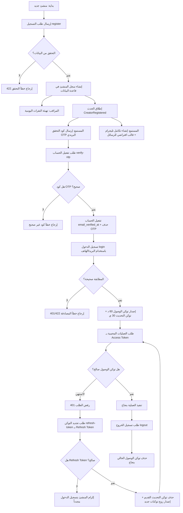
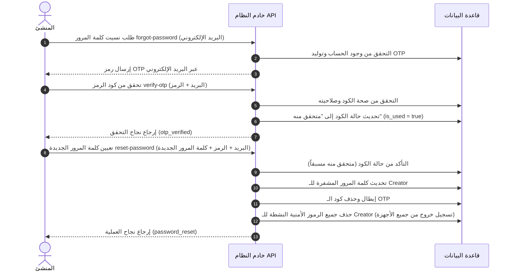

# نظام المصادقة والتحقق (Authentication & Verification System)

يقدم هذا المستند شرحاً تفصيلياً لنظام المصادقة (Auth) الخاص بصناع المحتوى (Creators) في المنصة، بما يشمل عمليات التسجيل، التحقق البريدي، تسجيل الدخول، استعادة كلمة المرور، وإدارة دورة حياة الرموز الأمنية (Tokens).

يعتمد النظام على **Laravel Sanctum** لإصدار الرموز الأمنية مع الفصل بين صلاحيات رمز الوصول (Access Token) ورمز التحديث (Refresh Token) لضمان أعلى مستويات الأمان.

---

## 1. عملية تسجيل الحساب (Registration Flow)

عندما يقوم منشئ محتوى جديد بتسجيل حساب:

1. **إرسال الطلب**: يستقبل النظام البيانات عبر مسار `POST /api/auth/register` ويقوم بالتحقق منها باستخدام `RegisterRequest`:
   * **`name`**: الاسم (مطلوب، نص، من 3 إلى 255 حرفاً).
   * **`country_id`**: معرف الدولة (مطلوب، موجود في جدول الدول).
   * **`phone`**: رقم الهاتف (مطلوب، فريد، ويتم التحقق من طوله ديناميكياً بناءً على كود الدولة المحدد عبر `PhoneNumberLengthRule`).
   * **`categories`**: تصنيفات المنشئ المفضلة (مطلوب، مصفوفة معرفات تصنيفات صالحة).
   * **`email`**: البريد الإلكتروني (مطلوب، بريد صالح، فريد).
   * **`gender`**: الجنس (مطلوب، ذكر أو أنثى).
   * **`password`**: كلمة المرور (مطلوبة، الحد الأدنى 8 أحرف، ومطابقة للتأكيد `confirmed`).

2. **حفظ البيانات في قاعدة البيانات**:
   * يتم إنشاء سجل المنشئ في جدول `creators` ببياناته الأساسية.
   * يتم ربط التصنيفات المحددة بالمنشئ في جدول الربط `category_creator`.

3. **المراقب (Observer)**:
   * يقوم `CreatorObserver` برصد إنشاء الحساب تلقائياً، ويقوم بإنشاء سجل تمهيدي في جدول `daily_clicks` لليوم السابق بقيمة `0` لتهيئة نظام تتبع النقرات اليومي للمنشئ.

4. **إطلاق الحدث (CreatorRegistered Event)**:
   * يتم إطلاق الحدث `App\Events\CreatorRegistered` لتشغيل العمليات الخلفية المترابطة بالتسجيل تلقائياً.

5. **المستمعون (Listeners)**:
   * **`SendEmailVerification`**: 
     * يقوم بتوليد رمز تحقق مؤقت (OTP) مكون من 6 أرقام بربطه ببريد المنشئ ونوع `email_verification`.
     * يقوم بجدولة وظيفة خلفية (`SendOtpEmailJob`) لإرسال الرمز لبريد المنشئ.
     * يطبق نظام حماية ومحدودية للطلب (Rate Limiting) يمنع طلب كود جديد قبل مرور 60 ثانية.
   * **`CreateDefaultTelegramIntegration`**:
     * يقوم بإنشاء تكامل تليجرام تلقائي نشط (`active`) بالقيم الافتراضية في جدول `social_integrations` ليكون جاهزاً للاستخدام الفوري.
     * يقوم بإنشاء قالب محتوى افتراضي (`ContentTemplate`) باللغة العربية مرتبط بتكامل التليجرام المنشأ حديثاً لتسهيل صياغة العروض الفورية للمنشئ.

---

## 2. التحقق من البريد الإلكتروني (Email Verification OTP)

بعد التسجيل، لا يكون حساب المنشئ مفعلاً بالكامل حتى يتم التحقق من بريده الإلكتروني:

1. **إرسال رمز التحقق**: يرسل المنشئ الرمز المستلم عبر بريده إلى مسار `POST /api/auth/verify-otp`.
2. **التحقق**: يتأكد النظام من صحة الرمز، عدم انتهاء صلاحيته (10 دقائق)، ومطابقته لنوع الطلب `email_verification`.
3. **التفعيل**:
   * يتم تحديث حقل `email_verified_at` بالتاريخ الحالي في جدول `creators`.
   * يتم حذف رمز الـ OTP المستخدم لمنع إعادة استعماله.

---

## 3. تسجيل الدخول وإدارة الرموز (Login & Token Management)

1. **الطلب**: يرسل المنشئ بيانات تسجيل الدخول إلى مسار `POST /api/auth/login`:
   * **`identifier`**: معرف المنشئ (يمكن أن يكون البريد الإلكتروني أو رقم الهاتف).
   * **`password`**: كلمة المرور.
2. **التحقق**: يبحث النظام عن الحساب باستخدام المعرف ويتحقق من مطابقة كلمة المرور المشفرة.
3. **إصدار التوكنات الثنائية (Dual Token System)**:
   * **توكن الوصول (Access Token)**: يُمنح صلاحية `access` فقط، ويكون صالحاً لمدة **60 دقيقة**. يُستخدم هذا الرمز لإجراء جميع العمليات المحمية في التطبيق.
   * **توكن التحديث (Refresh Token)**: يُمنح صلاحية `refresh` فقط، ويكون صالحاً لمدة **30 يوماً**. لا يمكن استخدامه للوصول إلى العمليات المحمية العادية، بل يُستخدم فقط لتحديث توكن الوصول المنهي صلاحيته.

---

## 4. تجديد التوكن (Token Refresh Flow)

عند انتهاء صلاحية توكن الوصول (Access Token)، يستعمل تطبيق الواجهة توكن التحديث المخزن لتفادي تسجيل خروج المستخدم:

1. **الطلب**: يرسل التطبيق التوكن الحالي إلى مسار `POST /api/auth/refresh-token` محتوياً على حقل `refresh_token`.
2. **التحقق**:
   * يتأكد النظام من صحة توكن التحديث، وأنه يحتوي على الصلاحية `refresh` فقط، ولم تنتهِ صلاحيته الـ 30 يوماً.
3. **إعادة الإصدار**:
   * يقوم النظام بحذف توكن التحديث القديم فوراً لمنع سرقته أو تكراره.
   * يقوم بإصدار توكن وصول جديد (60 دقيقة) وتوكن تحديث جديد (30 يوماً) وإرجاعهما للمستخدم.

---

## 5. استعادة كلمة المرور (Password Reset Flow)

إذا نسي المنشئ كلمة المرور الخاصة به، يتبع الخطوات التالية:

1. **طلب الاستعادة (`POST /api/auth/forgot-password`)**:
   * يرسل المنشئ بريده الإلكتروني.
   * يتحقق النظام من وجود البريد، ثم يرسل رمز OTP بنوع `password_reset` لبريد المنشئ.
2. **تحقق الرمز (`POST /api/auth/verify-otp`)**:
   * يتحقق النظام من صحة الرمز وصلاحيته بنوع `password_reset`.
   * في حال المطابقة، يتم تعليم الرمز كـ "متحقق منه" (`is_used = true` ولكن لا يُحذف في هذه المرحلة لإثبات التحقق للخطوة القادمة).
3. **تعيين كلمة المرور الجديدة (`POST /api/auth/reset-password`)**:
   * يرسل المنشئ البريد، كود الـ OTP، وكلمة المرور الجديدة مع تأكيدها.
   * يتأكد النظام من أن كود الـ OTP الخاص بهذا البريد قد تم التحقق منه مسبقاً بنجاح.
   * يتم تحديث كلمة المرور في سجل المنشئ.
   * يتم حذف كود الـ OTP نهائياً.
   * **صمام أمان أمني**: يتم حذف وإبطال جميع التوكنات النشطة (`personal_access_tokens`) الخاصة بالمنشئ لإجباره على تسجيل الخروج من كافة الأجهزة وحماية حسابه.

---

## 6. تسجيل الخروج (Logout)

* عند استدعاء مسار تسجيل الخروج `POST /api/auth/logout`:
  * يتم التعرف على الرمز المرفق في الطلب (الـ Access Token المستخدم حالياً).
  * يقوم النظام بحذف الرمز الحالي فقط من قاعدة البيانات لتسجيل الخروج من الجهاز الحالي دون التأثير على تسجيلات الدخول الأخرى للمنشئ على الأجهزة الأخرى.

---

## 7. مخطط تدفق العمليات (Authentication Flowchart)

يوضح المخطط التالي دورة حياة التسجيل، التحقق، تسجيل الدخول، والتحديث بالتفصيل:

---

## 8. ملخص استعادة كلمة المرور (Password Reset State Flow)

