# دليل تدفق عمليات النشر (Publishing Workflow Document)

يوضح هذا المستند التدفق الكامل والدقيق لعمليات اختيار المنتجات، والتحقق من صحة أسعارها عبر خادم Flask، ونشرها على قنوات تليجرام، مع تفصيل كامل لجميع الحالات الاستثنائية وحالات الفشل والتعافي.

---

## مخطط التدفق العام (Workflow Diagram)

```mermaid
graph TD
    Start([جدولة النظام Cron Job]) --> Command[app:send-telegram-products]
    Command --> LoopIntegrations[لكل قناة تليجرام نشطة]
    LoopIntegrations --> DispatchSelection[إطلاق ProductSelectionJob]
    
    subgraph ProductSelectionJob [1. مرحلة اختيار المنتج]
        CheckLock{هل تم حجز القفل سابقاً؟}
        CheckLock -- لا --> AcquireLock[محاولة حجز قفل Redis للقناة لمدة 300 ثانية]
        AcquireLock -- فشل الحجز --> ExitSelection([إنهاء الوظيفة - القناة مشغولة])
        AcquireLock -- نجاح الحجز --> CheckCategory
        CheckLock -- نعم --> CheckCategory{تحديد الفئة category}
        
        CheckCategory --> QueryProduct[البحث عن المنتج الأعلى تقييماً]
        QueryProduct --> ExcludeList[استبعاد المنتجات في excludedProductIds]
        ExcludeList --> DedupFilters[استبعاد المنشور في آخر 24س للقناة و3س عالمياً]
        
        CheckProductExists{هل وُجد منتج مؤهل؟}
        CheckProductExists -- لا --> UpdateCatTimestamp[تحديث last_posted_at للفئة الخالية]
        UpdateCatTimestamp --> LoopNextCategories[تجربة باقي فئات القناة بالتدوير]
        LoopNextCategories --> CheckExhausted{هل نفدت كل الفئات؟}
        CheckExhausted -- نعم --> FreeLockExit[فك قفل Redis وإنهاء الدورة]
        CheckExhausted -- لا --> QueryProduct
        
        CheckProductExists -- نعم --> CheckFlaskHealth{فحص حالة خادم Flask}
        CheckFlaskHealth -- متوقف --> FreeLockExit
        CheckFlaskHealth -- يعمل --> DispatchValidation[إطلاق ValidateProductDataJob]
    end

    DispatchValidation --> ValidateJob[2. مرحلة التحقق من البيانات]
    
    subgraph ValidateProductDataJob [2. مرحلة التحقق من البيانات]
        CallFlaskValidate[طلب POST /validate من Flask بمهلة 30 ثانية]
        CallFlaskValidate --> FlaskResponseStatus{حالة استجابة Flask}
        
        FlaskResponseStatus -- "same / higher / lower" --> DispatchPublish[إطلاق SendMessageToTelegramJob]
        
        FlaskResponseStatus -- "out_of_stock / unavailable" --> UpdateProductStatus[تحديث حالة المنتج بالجدول]
        UpdateProductStatus --> HandleRetrySelection{هل retryCount < 3؟}
        HandleRetrySelection -- نعم --> DispatchReselection[إعادة إطلاق ProductSelectionJob <br> مع تمرير lockAlreadyAcquired=true <br> وإضافة المنتج الحالي للمستبعدات]
        HandleRetrySelection -- لا --> ReleaseLockExit[فك قفل Redis وإنهاء المحاولات]
        
        FlaskResponseStatus -- "فشل شبكة / 5xx / خطأ بنيوي" --> ThrowException[رمي استثناء لـ Laravel]
        ThrowException --> LaravelRetry[إعادة محاولة Laravel تلقائياً <br> تراجع تدريجي 10ث ثم 30ث ثم 60ث]
        LaravelRetry -- بعد 3 فشل نهائي --> CleanFailedValidate[فك قفل Redis وتسجيل خطأ بالـ logs]
    end

    DispatchPublish --> PublishJob[3. مرحلة النشر على تليجرام]
    
    subgraph SendMessageToTelegramJob [3. مرحلة النشر على تليجرام]
        StartTransaction[بدء معاملة قاعدة بيانات DB Transaction]
        StartTransaction --> Check3HourDup{هل نُشر المنتج في آخر 3 ساعات بقفل lockForUpdate؟}
        Check3HourDup -- نعم --> FreeLockExitPublish[فك قفل Redis وتجاهل النشر]
        Check3HourDup -- لا --> GenerateData[توليد رابط التتبع وجلب القالب]
        
        GenerateData --> CallFlaskPublish[طلب POST /send-telegram من Flask بمهلة 30 ثانية]
        CallFlaskPublish --> FlaskPublishStatus{حالة النشر من Flask}
        
        FlaskPublishStatus -- "نجاح الإرسال 2xx" --> InsertPostedRecord[إدراج منشور ناجح posted بالجدول]
        InsertPostedRecord --> UpdateCategoryPosted[تحديث last_posted_at للفئة]
        UpdateCategoryPosted --> SuccessEnd([نهاية النشر بنجاح - القفل يزول تلقائياً بعد 300 ثانية لتأمين التباعد])
        
        FlaskPublishStatus -- "rate_limited" --> ReleaseJob[تأجيل الوظيفة يدوياً release <br> بناءً على retry_after من تليجرام]
        
        FlaskPublishStatus -- "rejected (400/403)" --> DisableChannel[إيقاف القناة inactive]
        DisableChannel --> FreeLockFail[فك قفل Redis وإفشال الوظيفة فوراً]
        
        FlaskPublishStatus -- "فشل شبكة / 5xx" --> ThrowExceptionPublish[رمي استثناء لـ Laravel]
        ThrowExceptionPublish --> LaravelRetryPublish[إعادة محاولة Laravel تلقائياً <br> تراجع تدريجي 10ث ثم 30ث ثم 60ث]
        LaravelRetryPublish -- بعد 3 فشل نهائي --> CleanFailedPublish[دالة failed: فك قفل Redis وتسجيل الخطأ]
    end
```



---

## تفاصيل الحالات والسيناريوهات (Edge Cases & Failure Scenarios)

### أولاً: مرحلة الاختيار والدوران (Selection & Category Rotation)
1. **الفئة الخالية من المنتجات (Empty Category)**:
   * **المشكلة**: إذا كانت الفئة الحالية التي حان دورها لا تحتوي على منتجات نشطة تطابق شروط الفلترة، فإن النظام لا يتوقف.
   * **الحل**: يقوم النظام بتحديث التوقيت `last_posted_at` للفئة الخالية فوراً إلى الوقت الحالي، ثم ينتقل للفئات التالية في الطابور الدائري. هذا يمنع بقاء الفئة الفارغة كعقبة تُعطل الدوران.
2. **تمرير ونقل قفل القناة (Lock Transfer)**:
   * **المشكلة**: عند فشل التحقق من منتج (مثلاً لكونه غير متوفر)، نريد اختيار منتج بديل فوراً دون انتظار انتهاء صلاحية قفل القناة (300 ثانية).
   * **الحل**: يتم إطلاق وظيفة الاختيار البديلة `ProductSelectionJob` مع إعداد المعلمة `lockAlreadyAcquired = true`. يكتشف الكود هذه القيمة فيتجاوز حجز قفل جديد في Redis، ويستخدم القفل المحجوز مسبقاً، ويمنع حذفه حتى انتهاء دورة الاختيار.
3. **تجنب تكرار اختيار نفس المنتج الفاشل (Failed Product Exclusion)**:
   * **المشكلة**: في حال فشل منتج في مرحلة التحقق، يجب ألا يقوم محرك الاختيار البديل بإعادة ترشيحه في نفس الدورة.
   * **الحل**: يتم تجميع معرفات المنتجات الفاشلة في مصفوفة `excludedProductIds` وتمريرها عبر جميع الوظائف المتعاقبة، ويتم استبعادها في استعلام الاختيار عبر دالة `->whereNotIn('p.id', $this->excludedProductIds)`.

---

### ثانياً: مرحلة التحقق (Validation Stage)
1. **أخطاء خادم Flask أو الاستدعاء (Flask Connection / Timeout / 5xx)**:
   * **السلوك**: في حال تعطل خدمة Flask أو استغراقها أكثر من 30 ثانية، ترمي الوظيفة استثناءً بنيوياً.
   * **التعافي**: يقوم Laravel بإعادة المحاولة بموجب الإعدادات التلقائية المضافة حديثاً للوظيفة:
     * عدد المحاولات الأقصى: `tries = 3`
     * مهلة تشغيل العامل: `timeout = 60` ثانية
     * أوقات التراجع: بعد 10 ثوانٍ، ثم 30 ثانية، ثم 60 ثانية.
   * **الفشل النهائي**: في حال استنفاد المحاولات الثلاث، يتم استدعاء دالة `failed()` لتقوم بفك القفل من Redis وتسجيل تقرير الخطأ لتنبيه الإدارة.

2. **المنتج غير متوفر أو محذوف (`out_of_stock` / `unavailable`)**:
   * **السلوك**: يتم تحديث حالة المنتج في قاعدة البيانات (لتصبح `out_of_stock` أو `unavailable`) ويُصفر تقييمه لمنع ترشيحه لاحقاً.
   * **التعافي**: يتم فك القفل أو نقله وإعادة إطلاق الاختيار فوراً كما موضح في آلية نقل القفل (حتى 3 محاولات كحد أقصى للـ Re-selection).

---

### ثالثاً: مرحلة النشر على تليجرام (Publishing Stage)
1. **الوقاية التامة من النشر المزدوج (Idempotency Guard)**:
   * **السيناريو**: تليجرام يستقبل الرسالة وينشرها بنجاح، ولكن خادم Laravel ينهار أو يفقد الاتصال بقاعدة البيانات قبل تسجيل حالة النشر.
   * **الحماية**: عند إعادة تشغيل الوظيفة المنهارة، تقوم بالتحقق داخل معاملة قاعدة بيانات مؤمنة بقفل الصفوف `lockForUpdate()` للتأكد مما إذا كان نفس المنتج قد نُشر بنجاح على هذه القناة في آخر 3 ساعات:
     ```php
     DB::transaction(function () use (&$shouldSkip) {
         $exists = DB::table('telegram_product_posts')
             ->where('product_id', $this->product['id'])
             ->where('post_status', 'posted')
             ->where('posted_at', '>', now()->subHours(3))
             ->lockForUpdate()
             ->exists();

         if ($exists) {
             Redis::del($this->lockKey);
             $shouldSkip = true;
             return;
         }
     });
     ```
     إذا وُجد السجل، يتم إلغاء النشر فوراً وفك القفل لمنع إرسال منشور مكرر للمستخدمين.

2. **تجاوز حد تليجرام (Telegram Rate Limiting)**:
   * **السلوك**: عند تلقي استجابة `rate_limited` من Flask، تحتوي على قيمة التراجع المطلوبة.
   * **التعافي**: يتم استخدام الجدولة اليدوية المتأخرة عبر دالة `$this->release($retryAfter)` لتعود الوظيفة للطابور وتُنفذ بعد انقضاء مدة الحظر المحددة ديناميكياً من تليجرام.

3. **رفض البوت أو حظره من القناة (Telegram Rejected - 400/403)**:
   * **السلوك**: عند إرجاع حالة `rejected` (مثل طرد البوت أو القناة غير موجودة).
   * **التعافي**: يقوم الكود فوراً بإلغاء تنشيط القناة برمجياً بجعل حالتها `inactive` في جدول `social_integrations` لمنع إرسال طلبات فاشلة أخرى، ثم يفك قفل القناة في Redis ويفشل الوظيفة نهائياً دون تكرار.

4. **تنظيف دالة الفشل النهائي (`failed`)**:
   * عند الفشل الدائم لوظيفة النشر، تقوم دالة `failed()` بتحرير قفل القناة في Redis لتسجيل المنشورات التالية، وتكتب تفاصيل الاستثناء في سجلات النظام (Logs) دون كتابة أي سجلات إدراج أو تعديل بقاعدة البيانات لمنع تشويه حالة جدول المنشورات.
