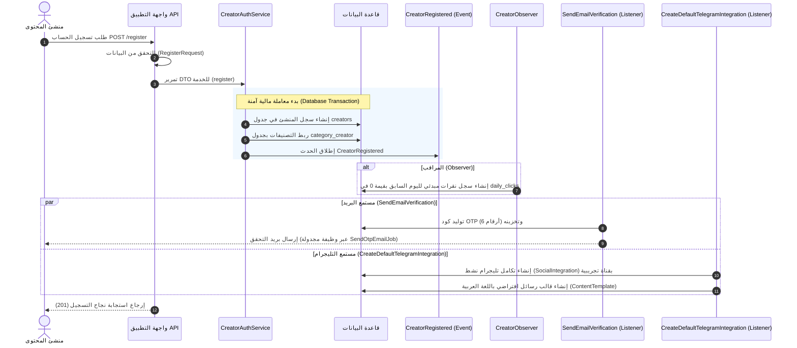

# توثيق عملية تسجيل الحساب لصناع المحتوى (Creator Registration Documentation)

يقدم هذا المستند توثيقاً فنياً وتفصيلياً لعملية تسجيل الحساب (Registration Flow) الخاصة بصناع المحتوى (Creators) في المنصة، بما يشمل مسارات الواجهة البرمجية (APIs)، قواعد التحقق (Validation Rules)، والعمليات الخلفية (Background Services & Listeners) التي يتم إطلاقها بمجرد التسجيل.

---

## 1. مسارات الواجهة البرمجية (API Endpoints)

تتكون عملية التسجيل من ثلاثة مسارات رئيسية:

### أ. جلب بيانات نموذج التسجيل (Registration Data)
يُستخدم هذا المسار لجلب الدول والتصنيفات المتاحة لعرضها في حقول الاختيار (Dropdowns) بالواجهة الأمامية.

*   **المسار:** `GET /api/auth/registration-data`
*   **الحماية (Middleware):** لا يوجد (عمومي).
*   **استجابة النجاح (200 OK):**
    ```json
    {
        "status": true,
        "message": "Data fetched successfully.",
        "data": {
            "countries": [
                {
                    "id": 1,
                    "name": "Egypt",
                    "iso2": "EG",
                    "phone_code": "+20",
                    "phone_min_length": 10,
                    "phone_max_length": 10,
                    "icon": "https://api.example.com/flags/eg.png"
                }
            ],
            "categories": [
                {
                    "id": 1,
                    "name": "Fashion"
                },
                {
                    "id": 2,
                    "name": "Electronics"
                }
            ]
        }
    }
    ```

---

### ب. تقديم طلب التسجيل (Register Account)
يُستخدم لإنشاء حساب منشئ محتوى جديد.

*   **المسار:** `POST /api/auth/register`
*   **الحماية (Middleware):** لا يوجد (عمومي).
*   **جسم الطلب (Request Body - JSON):**
    ```json
    {
        "name": "أحمد محمد",
        "country_id": 1,
        "phone": "1001234567",
        "categories": [1, 2],
        "email": "ahmed@example.com",
        "gender": "male",
        "password": "Password123",
        "password_confirmation": "Password123"
    }
    ```

#### قواعد التحقق المدخلة ([RegisterRequest](file:///d:/projects/new-teraffirax/teraffirax/app/Http/Requests/Auth/RegisterRequest.php)):

| الحقل | قواعد التحقق (Validation Rules) | الوصف |
| :--- | :--- | :--- |
| `name` | `required` \| `string` \| `min:3` \| `max:255` | اسم منشئ المحتوى. |
| `country_id` | `required` \| `integer` \| `exists:countries,id` | معرف الدولة (يجب أن يكون موجوداً بجدول الدول). |
| `phone` | `required` \| `string` \| `unique:creators,phone` \| `PhoneNumberLengthRule` | رقم الهاتف (فريد، ويتم التحقق من طوله ديناميكياً بناءً على كود الدولة المحدد). |
| `categories` | `required` \| `array` \| `min:1` | مصفوفة بمعرفات التصنيفات التي يهتم بها المنشئ. |
| `categories.*` | `required` \| `integer` \| `exists:categories,id` \| `distinct` | يجب أن تكون معرفات التصنيفات صالحة وغير مكررة. |
| `email` | `required` \| `email` \| `unique:creators,email` \| `max:255` | البريد الإلكتروني (فريد وصالح للمراسلة). |
| `gender` | `required` \| `in:male,female` | الجنس (ذكر أو أنثى فقط). |
| `password` | `required` \| `string` \| `min:8` \| `confirmed` | كلمة المرور (يجب أن تتطابق مع حقل التأكيد). |

> [!NOTE]
> **قاعدة التحقق من طول رقم الهاتف (`PhoneNumberLengthRule`):**
> تعتمد هذه القاعدة على جلب بيانات الدولة عبر معرف `country_id` ومقارنة طول الرقم المدخل بالحقول المحددة في جدول الدول (`phone_min_length` و `phone_max_length`).

*   **استجابة النجاح (201 Created):**
    ```json
    {
        "status": true,
        "message": "Creator registered successfully. Verification email sent.",
        "data": null
    }
    ```

*   **استجابة الفشل بسبب أخطاء التحقق (422 Unprocessable Content):**
    ```json
    {
        "status": false,
        "message": "The given data was invalid.",
        "errors": {
            "email": [
                "The email has already been taken."
            ],
            "phone": [
                "The phone must be exactly 10 digits."
            ]
        }
    }
    ```

---

### ج. تفعيل الحساب (Verify Account OTP)
بعد التسجيل بنجاح، يُغلق الحساب لحين التحقق من البريد الإلكتروني.

*   **المسار:** `POST /api/auth/verify-otp`
*   **جسم الطلب (JSON):**
    ```json
    {
        "email": "ahmed@example.com",
        "type": "email_verification",
        "otp": "123456"
    }
    ```
*   **استجابة النجاح (200 OK):**
    ```json
    {
        "status": true,
        "message": "OTP verified successfully. Your account is active.",
        "data": null
    }
    ```

---

## 2. دورة الحياة البرمجية للتسجيل (Backend Lifecycle)

بمجرد التحقق من صحة البيانات المرسلة في طلب التسجيل، يتولى النظام معالجتها عبر الخطوات التالية:



---

## 3. العمليات التلقائية اللاحقة للتسجيل (Observers & Listeners)

تتم معالجة تهيئة الحساب وإعداداته افتراضياً عبر هيكلية الأحداث (Events & Listeners) لضمان عدم حدوث بطء في استجابة الواجهة:

### 1. المراقب لقاعدة البيانات ([CreatorObserver](file:///d:/projects/new-teraffirax/teraffirax/app/Observers/CreatorObserver.php))
*   **الهدف:** تهيئة نظام مراقبة وإحصائيات النقرات للمنشئ الجديد.
*   **العملية:** عند نجاح إدراج سجل المنشئ، يقوم المراقب تلقائياً بإضافة سجل في جدول `daily_clicks` لليوم السابق بقيمة صفر لضمان وجود أساس يبني عليه النظام واجهة الرسوم البيانية.

### 2. مستمع التحقق من البريد ([SendEmailVerification](file:///d:/projects/new-teraffirax/teraffirax/app/Listeners/SendEmailVerification.php))
*   **العملية:**
    1.  يتحقق من وجود بريد المنشئ.
    2.  يقوم بتوليد رمز تحقق عشوائي (OTP) مكون من 6 أرقام بصلاحية تمتد لعشر (10) دقائق وبنوع `email_verification`.
    3.  يقوم بجدولة إرسال البريد عبر وظيفة خلفية (`SendOtpEmailJob`) لإبقاء أداء التطبيق سريعاً.
    4.  **تحديد سرعة الطلب (Rate Limiting):** يمنع المستمع إعادة طلب كود OTP جديد قبل مرور 60 ثانية لحماية الخادم من إرسال رسائل بريد عشوائية متكررة.

### 3. مستمع تهيئة التليجرام وقوالب الرسائل ([CreateDefaultTelegramIntegration](file:///d:/projects/new-teraffirax/teraffirax/app/Listeners/CreateDefaultTelegramIntegration.php))
*   **العملية:**
    *   يقوم بتهيئة تكامل تليجرام افتراضي للمنشئ وحفظه في جدول `social_integrations` بالحالة نشط (`active`) وبالبيانات التالية:
        *   اسم القناة الافتراضي: `Test Channel`
        *   اسم المستخدم الافتراضي: `test_channel`
        *   المعرف الخارجي الافتراضي: `123456789`
    *   يقوم بإنشاء قالب رسائل افتراضي (`ContentTemplate`) مربوط بالتكامل ويجعل له الأولوية (`is_default => true`) بالصيغة التالية باللغة العربية:
        ```text
        {{discount}}% خصم على {{product_name}} بسعر {{product_price}} 

        رابط العرض: {{link}}
        ```
    *   **الأمان البرمجي:** تتم العملية داخل كتلة `try-catch` موثقة عبر السجلات (`Log::error`) لضمان عدم إيقاف أو تعطيل عملية تسجيل المنشئ في حال فشلت عملية الربط التلقائي بأي شكل.

---

## 4. رموز الاستجابات والرسائل المترجمة (Localization Messages)

تعتمد الواجهة البرمجية على نظام الترجمة في لارافيل لإرجاع الرسائل بنصوص واضحة بناءً على اللغة المحددة بالطلب (`Accept-Language`):

*   **رسالة النجاح:** `messages.created` (تترجم إلى: "تم التسجيل بنجاح. تم إرسال بريد التحقق.")
*   **رسالة خطأ التحقق:** يتم إرجاعها تلقائياً باللغة المحددة عبر حزمة التحقق الافتراضية للارافيل.
