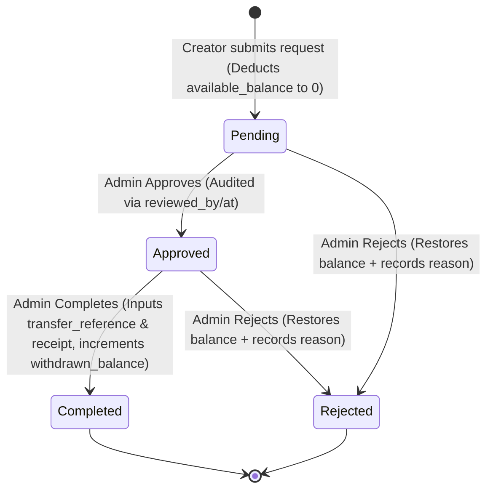

# دورة حياة عمليات السحب (The Withdrawal Cycle)

هذا المستند يشرح دورة حياة طلبات السحب بالتفصيل، بدءاً من تهيئة طرق السحب للمنشئ، مروراً بطلب السحب وخصم الأرصدة، ووصولاً إلى مراجعة الإدارة (سواء بالقبول، أو التحويل والتحقق، أو الرفض وإعادة الرصيد). 

تم تصميم هذه الدورة بموثوقية عالية وعمليات بنكية دقيقة (Transactions) مدعومة بقفل البيانات (Pessimistic Locking) لضمان عدم حدوث سحوبات مزدوجة أو تداخل في الحسابات المالية.

---

## 1. بنية طرق السحب (Withdrawal Methods System)

لإتاحة مرونة عالية في النظام لدعم مختلف الدول، يعتمد النظام على هيكلية ديناميكية لطرق السحب:

*   **`withdraw_methods`**: جدول يحتوي على طرق السحب المتاحة في المنصة (مثل: تحويل بنكي، فودافون كاش، باي بال) وتكون مرتبطة بكل دولة (`country_id`).
*   **`withdraw_method_fields`**: يحدد الحقول المطلوبة لكل طريقة سحب ديناميكياً (مثل: اسم البنك، رقم الحساب، الآيبان، رقم الهاتف) مع قواعد التحقق الخاصة بكل حقل (`validation`).
*   **`creator_withdraw_methods`**: يمثل طريقة السحب التي قام المنشئ بربطها وإعدادها في حسابه.
*   **`creator_withdraw_method_values`**: يحتوي على القيم الفعلية التي أدخلها المنشئ للحقول المطلوبة (مثل رقم حسابه البنكي الفعلي).

---

## 2. مرحلة تقديم طلب السحب (Withdrawal Request)

عندما يقرر المنشئ سحب أرباحه المتاحة:

1.  **اختيار طريقة السحب**: يختار المنشئ إحدى طرق السحب التي قام بإعدادها مسبقاً (`creator_withdraw_method_id`).
2.  **التحقق من الملكية**: يتأكد النظام من أن طريقة السحب المحددة تنتمي بالفعل لهذا المنشئ لمنع الاحتيال.
3.  **بدء العملية الآمنة (Database Transaction & Pessimistic Lock)**:
    *   يتم قفل سجل المنشئ في قاعدة البيانات (`findWithLock`) لمنع أي عمليات متزامنة تعدل على أرصدته في نفس اللحظة.
4.  **شروط قبول الطلب**:
    *   يجب أن يكون الرصيد المتاح للطلب (`available_balance`) أكبر من أو يساوي الحد الأدنى للسحب المحدد في الإعدادات (الافتراضي هو `500` ريال/جنيه أو كما هو محدد في إعدادات النظام `withdrawal.min_amount`).
    *   يجب ألا يكون لدى المنشئ أي طلب سحب آخر معلق أو موافق عليه لم يكتمل بعد (`pending` أو `approved`).
5.  **إنشاء الطلب وتصفير الرصيد**:
    *   يتم إنشاء سجل طلب السحب في جدول `withdraw_requests` بالحالة `pending` وبقيمة كامل المبلغ المتاح في الرصيد (`amount`).
    *   يتم خصم المبلغ بالكامل فوراً وتصفير رصيد المنشئ المتاح (`available_balance = 0`).
6.  **توثيق الحركة المالية (Ledger)**:
    *   يتم تسجيل حركة جديدة في جدول `balance_ledgers` بنوع `withdrawal_requested` لتوثيق خصم الرصيد مع ربطه بمعرف الطلب.

---

## 3. دورة مراجعة الإدارة والتحكم (Admin Review & Operations)

يمر طلب السحب عبر الإدارة بثلاثة مسارات أساسية:

### أ. الموافقة المبدئية (Approve Request)
يقوم مدير الحسابات بمراجعة الطلب والموافقة عليه مبدئياً:
*   تتغير حالة الطلب من `pending` إلى `approved`.
*   يتم توثيق المسؤول الذي قام بالموافقة في حقل `reviewed_by` وتاريخ المراجعة في حقل `reviewed_at`.
*   **تأثير الأرصدة**: لا يحدث أي تغيير في الأرصدة هنا، حيث تم خصم المبلغ مسبقاً عند تقديم الطلب وتصفير الرصيد المتاح لمنع المنشئ من طلب سحب آخر أثناء المراجعة.

### ب. إكمال عملية التحويل والتحقق (Complete Request)
بعد موافقة الإدارة، يقوم القسم المالي بالتحويل الفعلي للمال للمنشئ (مثلاً عبر الحوالة البنكية):
*   يقوم المسؤول بإدخال مرجع التحويل المالي (`transfer_reference`) وإرفاق رابط إيصال التحويل البنكي (`receipt_url`).
*   تتغير حالة الطلب من `approved` إلى `completed`.
*   يتم زيادة الرصيد التاريخي المسحوب للمنشئ **`withdrawn_balance`** بقيمة المبلغ المسحوب لتوثيق إجمالي المسحوبات التاريخية للمنشئ في المنصة.
*   **توثيق الحركة المالية (Ledger)**: يتم تسجيل حركة جديدة في جدول `balance_ledgers` بنوع `withdrawal_completed` لتوثيق اكتمال العملية بنجاح.

### ج. رفض الطلب وإرجاع المبالغ (Reject Request)
إذا تبين للإدارة أن هناك مشكلة في بيانات الحساب أو لأي سبب تنظيمي آخر:
*   يقوم المسؤول برفض الطلب مع كتابة سبب الرفض (`rejection_reason`).
*   تتحول حالة الطلب إلى `rejected`.
*   **إرجاع المبلغ (Restoring Balance)**: يبدأ النظام Transaction ويقفل سجل المنشئ، ثم يعيد قيمة طلب السحب إلى رصيد المنشئ المتاح **`available_balance`** مجدداً لتمكينه من تعديل بياناته وإعادة الطلب.
*   **توثيق الحركة المالية (Ledger)**: يتم تسجيل حركة جديدة في جدول `balance_ledgers` بنوع `withdrawal_rejected` لتوثيق استرداد وإرجاع المبلغ للرصيد المتاح.

---

## 4. ملخص حالات طلب السحب (State Machine)

---

## 5. صمام الأمان المالي (Financial Safety & Audit)

*   **جدول سجلات الأرصدة (`balance_ledgers`)**: يمثل الصندوق الأسود للنظام، حيث يتم تسجيل أي حركة خصم، أو تعليق، أو نضوج، أو سحب كحركة بنكية مستقلة تظهر الرصيد قبل وبعد الحركة والمسؤول عنها.
*   **المطابقة التلقائية (`ReconcileBalancesCommand`)**: 
    مهمة مجدولة يومية تقوم بمطابقة الأرصدة الحالية للمنشئين مع مجموع كافة الحركات المسجلة في الـ Ledgers والعمولات الناضجة والسحوبات المكتملة من نقطة الصفر. وفي حال وجود أي تباين ولو بسيط، يرسل النظام تنبيهاً فورياً لفريق التطوير (`reconciliation_alerts`) للتدخل يدعمه نظام عدم السماح بالتلاعب المالي.
